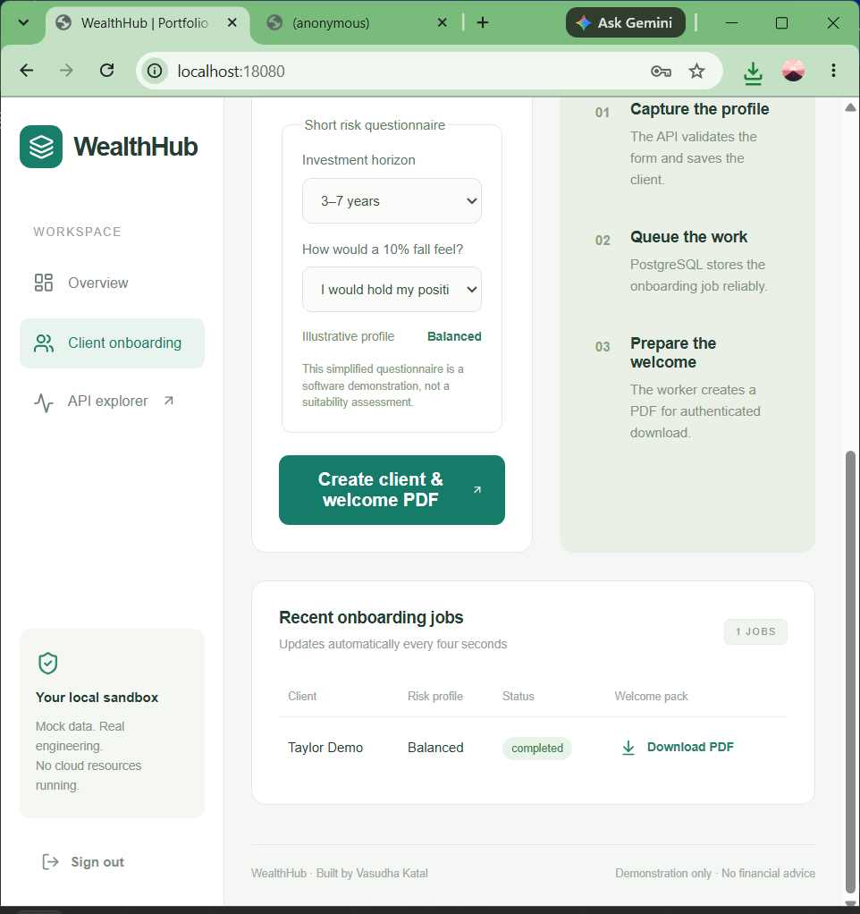
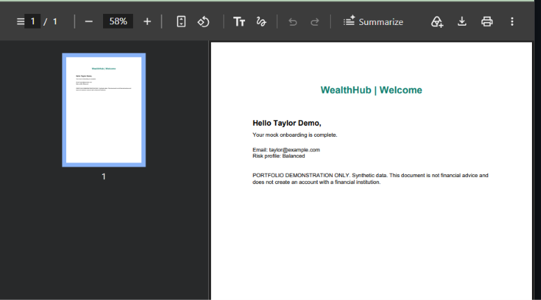
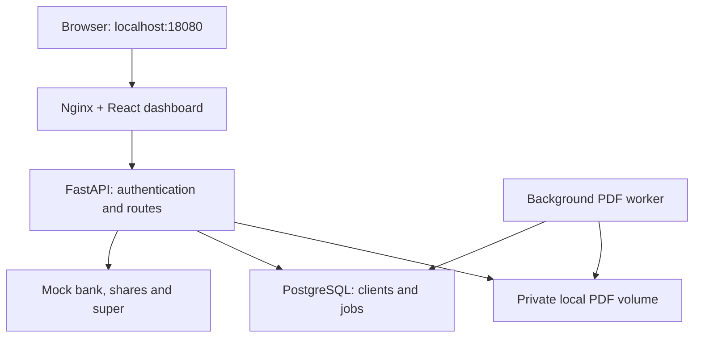

# WealthHub

### A mock wealth platform with automated client onboarding

WealthHub brings synthetic bank, share and superannuation data into one adviser dashboard. A client onboarding request creates a database-backed job; a separate worker generates a welcome PDF for authenticated download.

**By [Vasudha Katal](https://github.com/vasudhakatal26)** · React · FastAPI · PostgreSQL · Docker Compose

> **Current status:** working local application. Windows Docker startup and client-to-PDF flow were manually verified. Uses fictional data only. AWS and Terraform are planned extensions, not implemented or deployed.

[Quick start](#run-it-locally) · [Architecture](docs/architecture.md) · [Engineering decisions](docs/decisions.md) · [Test evidence](docs/verification.md) · [Security](docs/security.md) · [Roadmap](docs/roadmap.md)

## See the working application

Real screenshots from the local Docker application: the client job completed and its PDF opened successfully.

| Completed onboarding job | Generated welcome PDF |
| --- | --- |
|  |  |

**No live hosted demo:** this project runs locally to avoid cloud spending. A dashboard overview capture and short walkthrough video are still to be added. Screenshots above show the implemented onboarding flow, not a design mockup.

## What it does

| Capability | Implementation |
| --- | --- |
| Consolidated portfolio | Three synthetic connectors: bank, shares and super; AUD 244,000 sample total |
| Resilient aggregation | Independent source timeouts, one retry and explicit partial-result status |
| Portfolio dashboard | Holdings, asset allocation and a six-month illustrative performance chart |
| Demo authentication | Expiring JWTs, protected API routes and tokens held in browser memory |
| Client onboarding | Validated form and a simplified two-question risk-profile demonstration |
| Background processing | PostgreSQL jobs table, separate PDF worker and authenticated downloads |
| Repeatable local setup | Four containers, health checks, persistent database/PDF volumes |
| Automated checks | Included GitHub Actions workflow for Python tests/lint, UI build/audit and Compose integration |

## What this project demonstrates

A complete request moving through a UI, API, relational database, background worker and downloadable artifact. The code includes connector failure handling, transactional job creation, token validation, tests and documentation of practical trade-offs.

This is an AI-assisted personal portfolio project. Treat the source, test results and working demonstration as the evidence; no production deployment, commercial usage or sole manual authorship is claimed.

## Architecture at a glance



Only the dashboard publishes a host port, bound to loopback. Nginx proxies API requests; the API and worker share the database and PDF volume. [Detailed request flow and data model →](docs/architecture.md)

## Run it locally

**Requirements:** Docker Desktop running in Linux-container mode. Git and Python are useful for contributor checks; Node is only needed for host-side frontend development. The Windows installation used for the manual demo has 16 GB RAM.

### Windows — from a download

1. Extract the ZIP completely.
2. Open the folder containing `docker-compose.yml` and `README.md`. Some extraction tools create an extra outer folder; keep opening folders until those files are visible.
3. Type `powershell` in File Explorer’s address bar and press Enter.
4. Run:

```powershell
powershell -NoProfile -ExecutionPolicy Bypass -File .\scripts\setup.ps1
```

The execution-policy override applies only to that PowerShell process. The script preserves an existing `.env`, otherwise generates a random JWT secret, then builds and starts the stack. First startup downloads dependencies and can take several minutes.

### Windows — from GitHub

After the first code push, a fresh checkout can use:

```powershell
git clone https://github.com/vasudhakatal26/wealthhub-aws.git
cd wealthhub-aws
powershell -NoProfile -ExecutionPolicy Bypass -File .\scripts\setup.ps1
```

Linux/macOS: `sh scripts/setup.sh` (Python 3 is used to generate the local secret).

Open **http://localhost:18080**. Sign in with **`demo` / `local-demo-only`**. If you changed `DEMO_PASSWORD` in `.env`, use your changed value instead.

### Try it in two minutes

1. Explore the portfolio holdings and charts.
2. Open **Client onboarding**.
3. Enter **Taylor Demo** and **taylor@example.com**.
4. Answer the two sample risk questions and submit.
5. Wait for **completed**, then download the welcome PDF.

Use fictional information only. The risk rules are a software example, not a financial suitability assessment.

### Stop and restart

```powershell
docker compose stop
docker compose start
```

These preserve the database and PDFs. `docker compose down` removes this project's containers while retaining volumes. **`docker compose down -v` permanently deletes this project's client records and generated PDFs.** No global Docker cleanup is needed.

## Tests and verification

| Check | Evidence / current status |
| --- | --- |
| Backend behaviour | Seven pytest tests passed during development |
| Python lint | Ruff passed for API and worker |
| UI production build | Vite build passed |
| Frontend dependency audit | Zero reported vulnerabilities in the audit run at packaging time |
| Local Docker startup | User-provided Windows screenshot shows database/API healthy and worker/dashboard started |
| PostgreSQL onboarding and PDF | Manually exercised in the Windows Docker application; completion and opened PDF captured above |
| Browser automation | Not completed; the development environment blocked Chromium startup |
| GitHub CI | Workflow included; result pending first push and workflow run |
| AWS / Terraform | Not implemented or deployed |

No green CI badge is shown before a real successful run. [Exact checks, limitations and evidence →](docs/verification.md)

To run backend checks in PowerShell:

```powershell
python -m venv .venv
.\.venv\Scripts\python -m pip install -r api\requirements-dev.txt
.\.venv\Scripts\python -m pytest -q
.\.venv\Scripts\python -m ruff check api worker
```

Frontend checks:

```powershell
cd dashboard
npm ci
npm run build
npm audit --audit-level=high
```

From the root, while Compose is running, run `python scripts/smoke.py`. This creates an additional fictional client and verifies the HTTP flow through to PDF download. The smoke check uses the default demo password. For a different host port, set `$env:WEALTHHUB_URL = "http://localhost:YOUR_PORT"` first.

## Explore the API

Open **http://localhost:18080/api/docs** for interactive OpenAPI documentation.

| Method | Endpoint under `/api` | Purpose | Authentication |
| --- | --- | --- | --- |
| GET | `/health` | Database connectivity check | Public |
| POST | `/auth/login` | Exchange demo credentials for a bearer token | Public, throttled |
| GET | `/portfolio` | Aggregate mock sources and report source status | JWT |
| GET | `/performance` | Return synthetic performance history | JWT |
| POST | `/onboard` | Atomically create client + queued job | JWT |
| GET | `/jobs` | List the latest 50 onboarding jobs | JWT |
| GET | `/jobs/{id}` | Read job status | JWT |
| GET | `/jobs/{id}/pdf` | Download a completed welcome PDF | JWT |

Call `/auth/login`, copy its `access_token`, then use **Authorize** in the API explorer. Do not publish access tokens or `.env` contents.

## Repository map

| Location | What to inspect |
| --- | --- |
| `api/app/main.py` | Request validation, routes, atomic onboarding and throttling |
| `api/app/auth.py` | JWT issuance/validation and demo credential checking |
| `api/app/connectors.py` | Timeout/retry behaviour and partial aggregation |
| `api/app/db.py` | SQLAlchemy client/job models |
| `api/tests/` | Behaviour and failure-path tests |
| `worker/main.py` | Job claiming, PDF generation and crash/retry semantics |
| `dashboard/src/` | React dashboard, onboarding form and styles |
| `docker-compose.yml` | Network boundary, volumes and health dependencies |
| `.github/workflows/ci.yml` | Automated test, build and Compose integration jobs |
| `docs/` | Architecture, trade-offs, evidence, limitations and next work |

## Design decisions worth discussing

- **PostgreSQL queue:** fewer moving parts for a local demo; row locks support exclusive claiming. Trade-off: the worker holds a transaction during PDF generation. [Decision record](docs/decisions.md#database-backed-jobs).
- **Independent connectors:** a failed source does not hide available sources; the API explicitly marks it unavailable. Synthetic performance history is separate from current holdings.
- **Same-origin routing:** one browser entry point avoids separate frontend/API origins and keeps backend ports unpublished.
- **Local-first delivery:** a working demonstration without cloud spending. Cloud implementation remains a separate, unverified milestone.

## Security, limits and next steps

This is a **single-adviser local demonstration**, not a production financial service. All authenticated requests share the same demo identity. It has no real bank integrations, payments, multi-tenant authorization, TLS, identity provider or production migrations. Local volumes rely on host protection, and the local database demo password is visible in Compose.

[Security decisions and gaps →](docs/security.md) · [Troubleshooting →](docs/troubleshooting.md) · [Roadmap →](docs/roadmap.md) · [Future AWS design →](docs/aws-design.md)

Next priorities: confirm GitHub checks, capture the portfolio overview/video, add secret and container scanning, and then implement statically validated Terraform without applying paid resources. The `aws` repository suffix refers to that intended extension; the current implementation runs on Docker Compose only.
