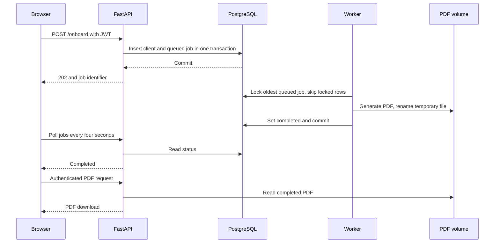
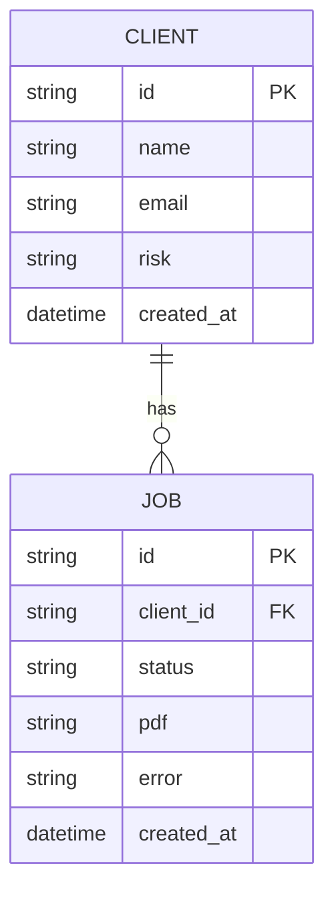

# Architecture and request flow

[Back to README](../README.md)

## Components and boundaries

| Component | Responsibility | Persistent state |
| --- | --- | --- |
| React + Nginx | Display the dashboard; proxy `/api/` to FastAPI | None; browser token is in memory |
| FastAPI | Authenticate, aggregate sources, validate onboarding, expose jobs/PDFs | Clients and jobs in PostgreSQL |
| Worker | Claim a job, build the welcome PDF, mark success/failure | Job state and PDF named volume |
| PostgreSQL | Store client profiles and the jobs queue | `pgdata` Docker volume |
| PDF volume | Share generated artifacts between API and worker | `pdfs` Docker volume |

The host exposes only `127.0.0.1:18080`. The database and API have no host port mappings. Docker's internal network is not a substitute for production network security.

## Onboarding sequence

A process crash before the worker's transaction commits releases the database lock. The queued record can be claimed again. The UUID filename makes regeneration overwrite the same artifact. A PDF-generation exception marks the job failed; no failed-job retry UI exists yet.

## Data model

The demo does not enforce unique emails, deduplicate repeated requests or track real client accounts. It creates tables from SQLAlchemy metadata at startup; schema migrations are future work.

## Aggregation behaviour

The API concurrently calls three synthetic connectors. Each source has a 0.6-second timeout, at most two attempts, and a short retry delay. Expected transport failures are isolated per source. The response contains available holdings and a status for each source; the total is the sum of available holdings, so it is a partial total if a source fails. Tests inject failures and slow connectors.

The historical performance series is fixed illustrative data, not recomputed from holdings. No external financial API is contacted.
